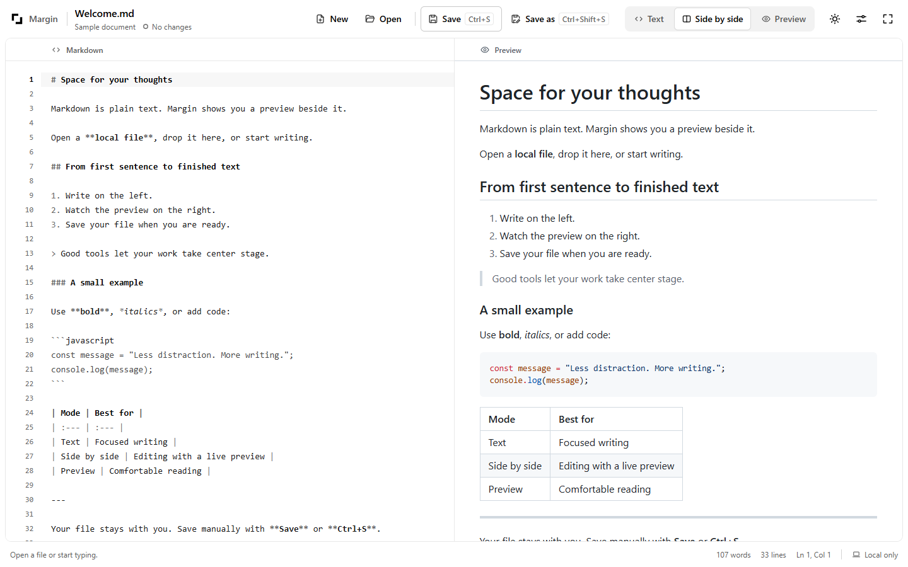
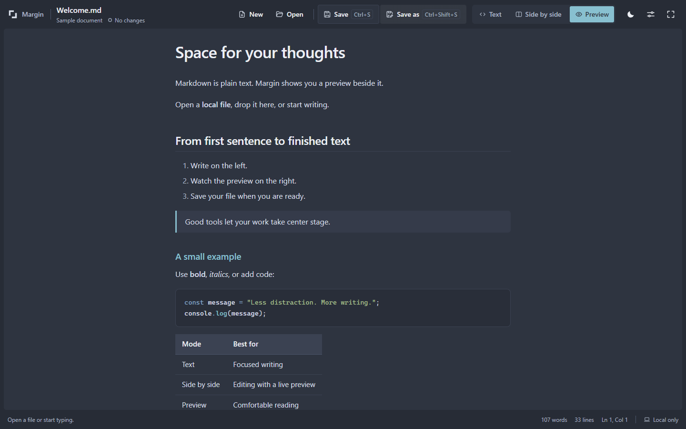

# Margin

A local Markdown editor for Chrome. Write the source, see a live preview, and save the file on your computer.

[](https://github.com/Majkey25/margin-md/actions/workflows/ci.yml)
[](https://github.com/Majkey25/margin-md/releases/latest)


[](https://github.com/Majkey25/margin-md/releases/latest/download/margin-md.zip)



## Install

1. [Download the latest extension ZIP](https://github.com/Majkey25/margin-md/releases/latest/download/margin-md.zip) and extract it into a folder you will keep.
2. Open `chrome://extensions` and enable **Developer mode**.
3. Click **Load unpacked** and select the extracted folder containing `manifest.json`.
4. Pin Margin and click its toolbar icon.

The icon returns to an existing editor without reloading its document. It prefers an editor in the current window and keeps private and normal windows separate. If no editor is open, it opens a new tab. The launch path runs independently of the background service worker; it adds no keepalive or polling.

No build tools are needed for the release ZIP. The release also includes `SHA256SUMS.txt` for verifying the download.

Chrome desktop is the supported installation target. The unpacked release also works in Brave. Margin is not published in the Chrome Web Store.

Updates are manual. Save open documents, replace the extracted extension files with a newer ZIP, and click **Reload** in `chrome://extensions`.

## Read and edit

The interface follows your device's preferred browser language. English, Czech and German are available; unsupported languages fall back to English. Choose an explicit language in **Appearance → Language** to override the device setting. Changing language preserves the open file, text and undo history.

Open a `.md` or `.markdown` file with **Open**, or drop it into the editor. Choose **Text**, **Side by side**, or **Preview**. Preview-only mode gives the document the full application area, and the fullscreen control expands the browser view.

**Save** writes to the opened file. **Save As** asks for a filename and destination folder, then asks before replacing an existing file. Choosing a destination does not empty an existing file. Save is manual; text remains in the editor if a write fails.

The theme button shows the current light or dark appearance. First open follows your device; clicking the button switches it with the circular reveal used on Init. Reduced motion disables the reveal. **Appearance** offers System, Light and Dark appearance, plus **Minimal**, **Glass**, **Material You**, **Fluent** and **Nord** visual styles. These preferences stay on this device; document contents are not stored with them. Material You uses a bundled tonal palette, not wallpaper colors from the operating system. Settings open in the center of the window, with a fixed close control and scrollable body.

Each style changes the window surfaces, controls and selection states. Fluent uses restrained Windows-inspired layers and blue accents. Nord uses an arctic palette with a Frost selection and separate light and dark layers. Settings group related controls and pair font with size; the close button remains reachable in short windows.

Choose the Markdown preview separately in **Markdown preview**:

| Preview | Default typography | Appearance |
| :--- | :--- | :--- |
| **GitHub** | System sans, 16 px | README-style headings, blue links, code chips and striped tables |
| **VS Code** | System sans, 14 px | Compact editor preview, bordered code and open tables |
| **Čtení** | Serif, 17 px | A quiet reading column with softer contrast |
| **Nord** | System sans, 16 px | Arctic reading surfaces, Frost accents and dark code blocks in both modes |

All four follow the current light or dark mode. They are inspired by their sources, not exact copies. Set the preview font and size independently from the source editor; **Use style default** restores the preset defaults. The editor offers system monospace, Cascadia, Consolas, sans-serif and serif stacks at 12–20 px. Missing fonts use installed fallbacks; nothing is downloaded. Changes apply immediately and preserve the document and undo history.

Choose **Code** for line numbers, an active line and Markdown syntax colors, **Writing** for syntax colors without line numbers, or **Plain text** without syntax colors. Every profile edits the raw Markdown. Switching profiles keeps your font, text, cursor, saved state and undo history.



Markdown supports headings, emphasis, links, quotes, nested lists, tables and disabled task checkboxes. Fenced JavaScript, TypeScript, JSX, TSX, JSON, CSS and HTML receive syntax colors. Highlighting is limited to 20,000 code characters per render; larger or unknown fences remain readable plain code. The preview does not edit task checkboxes; change their `[ ]` or `[x]` markers in the source.

| Shortcut | Action |
| :--- | :--- |
| `Ctrl+S` / `Cmd+S` | Save |
| `Ctrl+Shift+S` / `Cmd+Shift+S` | Save As |
| `Ctrl+Z` / `Cmd+Z` | Undo |

To render Markdown opened directly through a `file:///` URL, enable **Allow access to file URLs** in Margin's extension details. Files opened this way do not provide a writable file handle. Use **Uložit jako** to choose a save destination.

## Privacy and permissions

* Documents stay on your computer. There is no account, server, telemetry, or document upload.
* Dependencies, styles and icons are bundled. The extension loads no remote code or fonts.
* Markdown HTML is shown as text. Images are labelled placeholders, so opening a document does not contact image servers.
* HTTP(S) and email links open only after a click. Relative file links and images are not loaded.
* The `file:///*` permission supports directly opened local Markdown. The extension requests no access to HTTP(S) pages.
* Save As asks Chrome for access to the folder you select. Margin uses only the named target and does not enumerate the folder.

## File handling

One document is open per tab. Files must be UTF-8 and at most 5 MiB. UTF-8 BOM and the first newline convention are preserved; mixed line endings become consistent on save.

Unsaved changes trigger a discard guard or the browser's close warning. There is no autosave or crash recovery.

Save checks the destination's bytes before and after opening the temporary writable stream. A detected external change stops the write. This is not an atomic lock against another application changing the file afterward. A failed save to a newly created destination may leave a new empty file; it does not erase an existing destination through a save picker.

## Development

Use Node.js 24. Install dependencies with `npm ci`. `npm run dev` starts the local development server; Chrome extension integration uses the production build.

```sh
npm ci
npm test
npm run check
npm exec -- playwright install chromium
npm run test:browser
```

`npm run build` produces `dist/`. Load that folder as an unpacked extension when developing. The browser test also runs the type check and production build.

See [validation evidence](QA.md), [release changes](CHANGELOG.md), and [third-party notices](public/THIRD_PARTY_NOTICES.txt).
